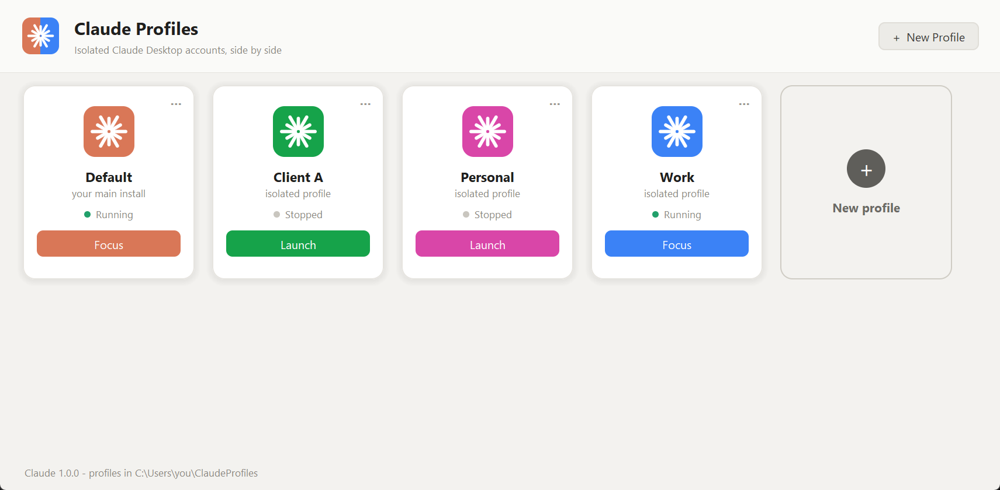
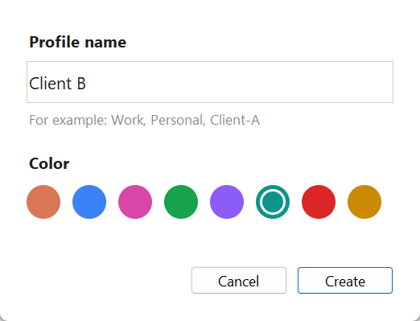
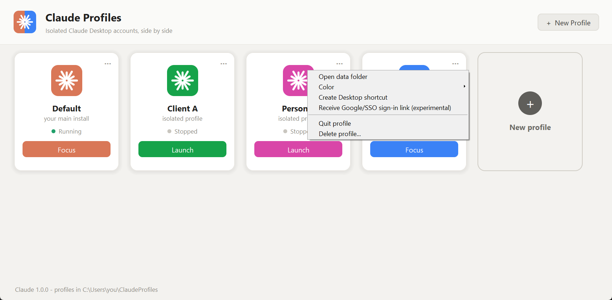

<p align="center">
  
</p>

<h1 align="center">Claude Desktop Profiles</h1>

<p align="center">
  Run several Claude Desktop accounts <b>side by side</b> on Windows and macOS: work, personal, one per client.<br>
  Each profile has its own sign-in, chats, settings, MCP servers and Claude Code data.
</p>

<p align="center">
  
  
  
</p>



> **Unofficial community tool.** It is not affiliated with, endorsed by or supported by Anthropic.
> "Claude" is a trademark of Anthropic. The app relies on an undocumented Electron flag
> (`--user-data-dir`), so a future Claude update may break it.

## Why

Claude Desktop is signed in to one account at a time. If you have a Team account at work and a
personal account, you keep signing out and back in. Claude Desktop is an Electron app, and Electron
keeps all of its state in one *user data folder*. Start it with a different folder and you get a
fully separate Claude: its own login, chats, projects, settings and connectors.

This app wraps that idea in a small window with one card per profile.

## Features

- **One card per profile**, each with its own color, a live *Running / Stopped* status and a
  **Launch / Focus** button.
- **Your existing Claude is never touched.** It appears as the *Default* card.
- **Claude Code isolation too.** Each profile gets its own `CLAUDE_CONFIG_DIR`, so the Code tab inside
  Desktop does not share the default `~/.claude` sign-in.
- **A colored taskbar button and tray icon per profile** (Windows). Each running profile gets its
  own taskbar button and its own system-tray icon in its color, named after the profile, instead of
  one more identical Claude icon.
- **A shortcut per profile**, with a colored icon: a Desktop shortcut on Windows, an app in
  `~/Applications` on macOS. It opens the profile directly, or focuses it if it is already running.
- **Nothing is copied.** Profiles start your installed Claude, so Claude updates reach every
  profile automatically. On Windows they go through the Store app's own launcher,
  `claude-desktop.exe`.
- **Python standard library only.** Tkinter for the window, no packages to install.
  No admin rights, no network calls, no telemetry.

## Requirements

| | Windows | macOS |
|---|---|---|
| OS | Windows 10 or 11 | Any macOS version Claude Desktop supports |
| Claude Desktop | From [claude.ai/download](https://claude.ai/download) or the Microsoft Store (MSIX build) | `Claude.app` in `/Applications` or `~/Applications` |
| Python | 3.9+ from [python.org](https://www.python.org/downloads/) (includes Tkinter) | 3.9+ with Tk 8.6: [python.org](https://www.python.org/downloads/) or `brew install python-tk` |

You need **one account per profile, with a different email address for each**.

> On macOS, the `python3` that comes with the Xcode Command Line Tools ships an old Tk 8.5 that the
> window does not support. The installer checks this and tells you what to install.

## Quick start

1. Download this repository: **Code -> Download ZIP**, then extract it. Or clone it:

   ```bash
   git clone https://github.com/duongnnbai/claude-profiles.git
   ```

2. Install the launcher:
   - **Windows:** double-click **`Install.cmd`**. It adds a **Claude Profiles** shortcut to your
     Desktop and Start menu.
   - **macOS:** double-click **`Install.command`** (if Finder refuses, right-click it and choose
     **Open**). It adds **Claude Profiles.app** to `~/Applications`.

   To try the app without installing anything, run this from the repository folder:

   ```bash
   python -m claude_profiles
   ```

   (`python3` on macOS, `py -3` on Windows if `python` is not on your PATH.)

3. Open **Claude Profiles**, click **+ New Profile**, enter a name and pick a color: one of the
   presets, a hex value such as `#FF8800`, or **Choose...** for the system color picker.

   

4. **Sign in once:** quit your other Claude windows, click **Launch** on the new card, and sign in
   with the other account. From then on every profile can run at the same time.

## Using profiles

Each card has a **...** menu (or right-click the card):



| Menu item | What it does |
|---|---|
| Open data folder | Opens the profile's folder in File Explorer / Finder |
| Color | Changes the card, shortcut, taskbar and tray color: one of the presets, or **Custom...** for any color |
| Create Desktop shortcut (Windows) / Create app in ~/Applications (macOS) | Adds `Claude <Name>` that opens this profile directly |
| Receive Google/SSO sign-in link (experimental, Windows only) | Sends `claude://` sign-in links to this profile. See [Troubleshooting](docs/TROUBLESHOOTING.md#the-sign-in-lands-in-the-wrong-window) |
| Quit profile | Closes that profile's Claude |
| Delete profile... | Deletes the profile's data after asking you to confirm |

### Command line

```bash
python -m claude_profiles                 # open the window
python -m claude_profiles --launch Work   # open (or focus) the "Work" profile without the window
python -m claude_profiles --list          # list profiles and whether they are running
python -m claude_profiles --install       # add launchers
python -m claude_profiles --uninstall     # remove the app, keep profile data
```

## Where things are stored

| What | Windows | macOS |
|---|---|---|
| App files, icons | `%LOCALAPPDATA%\ClaudeProfiles` | `~/Library/Application Support/ClaudeProfiles` |
| A profile's Desktop data (login, chats, settings) | `%USERPROFILE%\ClaudeProfiles\Claude-<Name>` | `~/Library/Application Support/Claude-<Name>` |
| A profile's Claude Code data | `%USERPROFILE%\.claude-<name>` | `~/.claude-<name>` |
| Launchers | Desktop and Start menu `.lnk` files | `~/Applications/*.app` |
| Taskbar registrations | `Start Menu\Programs\Claude Profiles\Claude <Name>.lnk` | Not used |
| Your default Claude | Unchanged | Unchanged |

On Windows, profiles are kept outside `AppData` on purpose. Claude runs as a Store app, and
Windows silently redirects whatever a Store app writes under `AppData` into the package's own
storage, which is deleted when Claude is uninstalled. See
[How it works](docs/HOW-IT-WORKS.md#windows-the-store-app-and-appdata).

## Uninstall

Double-click **`Uninstall.cmd`** (Windows) or **`Uninstall.command`** (macOS), or run
`python -m claude_profiles --uninstall`. This removes the launchers, the profile shortcuts and the
app's own folder. **Your profile data is kept.** To remove it too, delete the `Claude-<Name>` and
`.claude-<name>` folders listed above.

## Upgrading from an earlier version

Earlier versions (including the PowerShell `ClaudeProfiles.ps1`) ran a private copy of Claude and
kept profiles in `%APPDATA%\Claude-<Name>`. The first time this version starts, it moves each of
those profiles to `%USERPROFILE%\ClaudeProfiles` (sign-ins and chats move with them) and deletes the
old 700 MB copy. A profile that is still running is moved the next time, once you have quit it.
Run `Install.cmd` once too. It replaces the old shortcuts and refreshes any profile shortcuts you
had on the Desktop.

## Documentation

- [How it works](docs/HOW-IT-WORKS.md): the mechanism on each platform, and exactly what the app changes
- [Troubleshooting & FAQ](docs/TROUBLESHOOTING.md)

## Security & privacy

- No network access. The app never downloads or uploads anything.
- It never reads, copies or moves credentials between profiles. Each profile signs in on its own.
- It writes only to the folders listed above. On Windows the experimental sign-in option also adds
  one registry key under `HKCU\Software\Classes\claude\shell`, which **Restore** removes.
- Deleting is limited to folders and launchers the app created itself, which it tracks with marker files.

The code is small and readable: start with [`claude_profiles/core.py`](claude_profiles/core.py) and the
backend for your OS in [`claude_profiles/platforms/`](claude_profiles/platforms).

## Development

```bash
python -m unittest discover -s tests
```

## Changelog

### Unreleased

- **Shortcuts that explain themselves.** A shortcut whose files are missing now says so and where
  it looked, and falls back to the folder the app was installed from. `Install.cmd` refuses to run
  from a terminal inside Claude Desktop (or any Store app), whose sandbox would hide the installed
  files from Windows, and the automatic refresh of the installed copy is skipped there.
- **Launch log and sturdier launches.** Every launch and error is written to
  `claude-profiles.log` in the app folder, so a shortcut that "does nothing" can be diagnosed. On
  Windows a profile starts through the `claude-desktop.exe` alias without waiting for PowerShell,
  the package query falls back to its last answer, and error dialogs from shortcuts open on top.
- **Fix (Windows):** a `claude://` link handler left behind by the old PowerShell version could point
  at the private copy of Claude that this version removes, which would break browser sign-ins and
  "Open in Claude" links for every profile. The app now removes such a stale handler on startup.
- **Any color for a profile.** The new-profile dialog takes a hex value or opens the system color
  picker next to the presets, and the card's **Color** menu has a **Custom...** entry. Preset
  names keep working, so existing profiles are unchanged.
- **Windows:** each profile's system-tray icon now shows the profile's color, and its tooltip
  the profile's name, so running profiles can be told apart in the tray as well as on the
  taskbar. The color is applied when the profile starts and re-applied while Claude Profiles is
  open, the same way as the taskbar button. The default Claude's tray icon is never changed.

### 2.0.0

- First release of the Python app, replacing the PowerShell `ClaudeProfiles.ps1`.
- Profiles run the installed Claude instead of a private copy; profiles are moved out of
  `%APPDATA%` on first start.
- Colored taskbar button and shortcut per profile (Windows), launcher apps in `~/Applications`
  (macOS), Claude Code isolation through `CLAUDE_CONFIG_DIR`, experimental `claude://` sign-in
  routing (Windows).

## License

[MIT](LICENSE)
